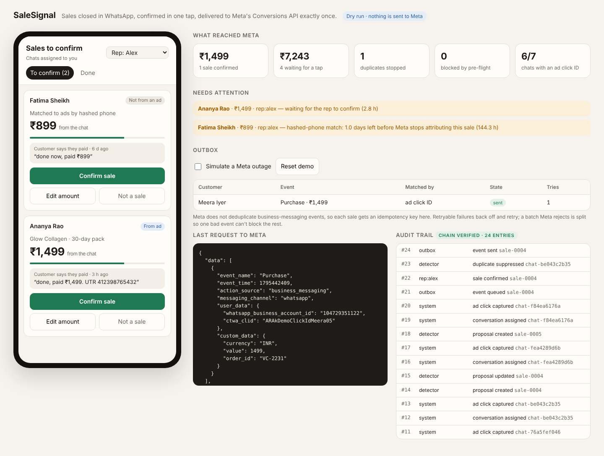

# SaleSignal

**Sales closed in WhatsApp, confirmed in one tap, delivered to Meta's Conversions API exactly once.**

A proof of concept I built for [Aixel](https://aixel.io), written in Go.



## The problem

Aixel promises that sales closed in a WhatsApp chat reach Meta, so click-to-WhatsApp campaigns learn from buyers, not just clicks. Two things can break that:

1. **The sale has to be recorded first.** In a WhatsApp CRM that usually means a rep marks the lead converted and types the revenue. A rep with 40 open chats on a phone will sometimes forget. The customer still paid, but Meta never hears about the sale, and the campaign looks worse than it is.
2. **Meta will not deduplicate these events for you.** Meta's guide for the Conversions API for Business Messaging says it [does not deduplicate business-messaging events](https://developers.facebook.com/documentation/ads-commerce/conversions-api/business-messaging) and asks advertisers to do it themselves. If a rep re-sends a receipt, or a retry fires twice, one sale can be reported as two Purchases and ROAS looks better than it is.

## What SaleSignal does

```
WhatsApp webhook ─► detector ─► one-tap card for the chat's owner
 (Cloud API)        (rules,      "Looks like Ananya paid ₹1,499"
                     evidence)    [Confirm]  [Edit amount]  [Not a sale]
                                        │
                                        ▼
                        pre-flight gate ─► outbox ─► Meta Conversions API
                        (spec checks,     (dedup key,   POST /v27.0/{dataset}/events
                         hashing, typo     retry with
                         cap)              backoff)
                                        │
                                        ▼
                           hash-chained audit trail of every decision
```

- **Spots the sale in the chat.** It catches *"paid ₹1,499, UTR 4123…"*, *"payment kar diya bhai"*, a UPI screenshot sent right after the rep asked for payment, and the rep's own *"received your payment"*. It then picks the amount: the one in the message, or the rep's last quote, skipping per-unit prices, phone numbers and UTRs.
- **A person decides.** The card shows *why* the detector thinks it's a sale (the actual messages) and the amount it found. Nothing reaches Meta until the chat's owner taps Confirm. A wrong Purchase would teach Meta to look for the wrong buyers.
- **Checks the event before it leaves.** Spec fields, `ctwa_clid` sent raw (never hashed), phone normalised and SHA-256 hashed, no raw PII, no future timestamps, and a per-workspace cap that catches ₹149900 typed for ₹1,499.
- **Sends each sale once.** Each event gets an idempotency key (order ref or first evidence message). A re-sent receipt in the same chat is recognised as the sale already sent. A new order in the same chat still gets its own card.
- **Survives Meta being down.** Retryable failures (429, 5xx, network) back off and retry. If Meta rejects a whole batch for one bad event, the batch is split so only that event fails.
- **Nudges the right person.** Sales waiting more than an hour are flagged to their owner. Chats that didn't start from an ad are flagged when they get close to the 7-day window in which Meta can attribute them.

## Try it

```bash
go run ./cmd/salesignal          # Go 1.22+, no dependencies
open http://localhost:8080
```

It starts in **dry-run mode** with demo chats for a fictional D2C brand, played through the real webhook path. Nothing is sent to Meta. Things to try:

1. **Edit Ananya's amount to 149900** (signed in as Alex) and confirm. The pre-flight check stops it as a likely typo. Fix it to 1499 and confirm: the request that would go to Meta appears on the right.
2. **Confirm Fatima's sale.** Her chat didn't start from an ad, so the event goes by hashed phone, with a warning.
3. **Switch to Priya and try Alex's chat.** Reps can only confirm their own chats. Admin can confirm any chat.
4. **Turn on "Simulate a Meta outage"**, confirm a sale, watch it retry, then turn the outage off and watch it go through.
5. **Look at Meera's chat in the audit trail.** Her sale was sent, then the rep re-sent the receipt, and the duplicate was suppressed.
6. Sana's chat (cash on delivery) and Vikram's chat ("will pay tomorrow") correctly produce no card.

To send real events, set `META_DATASET_ID`, `META_ACCESS_TOKEN`, `WABA_ID` and `PAGE_ID`. To receive Meta's webhooks, set `WEBHOOK_VERIFY_TOKEN` and `META_APP_SECRET` (signatures are checked with `X-Hub-Signature-256`).

## Design decisions

| Decision | Why |
|---|---|
| Rules, not an LLM, for detection | It runs on every message (~42 µs per message, see below), costs nothing, and every rule that fires is shown to the rep as evidence. An LLM belongs in the uncertain band (score 0.3–0.6), trained on the reps' confirm/reject taps. |
| A person confirms every sale | A false Purchase does more damage than a missed one. A missed sale can still be marked by hand; a false one trains Meta's delivery on the wrong buyer. The eval gate holds precision ≥ 0.95, higher than recall (≥ 0.85). |
| `event_time` = when the sale happened in the chat, not when the rep tapped | A rep who confirms 3 hours later shouldn't shift the conversion 3 hours. |
| Click ID path vs hashed-phone path | Chats from an ad carry `ctwa_clid` + WABA ID, exactly as in Meta's sample. Organic chats fall back to `page_id` + hashed phone, which Meta says only attributes within 7 days, so those get the deadline nudge. |
| Cash on delivery is not a Purchase | No money has moved. That chat is an `OrderCreated` (supported by Meta) until delivery. |
| Webhook redelivery is ignored by message ID | Meta retries webhooks, and the same message must not count twice. |
| Conversation IDs are derived, not the phone number | IDs show up in URLs, logs and the audit trail. Phones are shown masked (`+9198•••••345`). |
| Hash-chained audit log | Who confirmed what amount, what the gate blocked and what was sent, in a form where editing history is detectable. These are the records you need when a client asks why their Meta numbers changed. |

## How good is the detector?

`go run ./cmd/eval` scores it on 53 hand-labelled chats ([eval/chats.json](eval/chats.json)): D2C, a Qatar pharmacy (QAR), a clinic (AED), real estate, a course, coffee. The negatives are deliberately hard: cash on delivery, "paid ad", failed then retried payments, refunds, "I'll pay tonight", a screenshot captioned with a question.

| | |
|---|---|
| Sales found | 25 of 28 (recall 0.89) |
| False alarms | 1 of 26 non-sales (precision 0.96) |
| Amount and currency exactly right | 25 of 25 |

The 3 misses are left in on purpose (*"check your account, it's sorted"*, a bare ✅, *"amount debited from my side"*). They show the kind of phrasing an LLM fallback would catch. The false alarm is a customer who "paid my electricity bill" and messaged the wrong business. The rep's tap is what stops it.

**Caveat:** I wrote both the rules and the chats, so treat these numbers as a regression harness, not an accuracy claim. The real test is a few hundred anonymised Aixel chats.

## Tests

```bash
go test ./...                                    # 48 test cases: detector, money parsing, CAPI spec + gate,
                                                 # outbox retry/dedup/poison batch, audit tamper, webhook
                                                 # signature, service end-to-end, HTTP API, eval gate
go test ./internal/detect -bench . -benchmem     # ~0.34 ms for an 8-message chat (~42 µs per message)
```

## Layout

```
cmd/salesignal      server: webhook, rep/ops API, demo UI, outbox worker
cmd/eval            prints the detector's scorecard
internal/detect     sale detector + amount/currency parser
internal/capi       event builder, pre-flight gate, Meta sender (HTTP + dry run)
internal/outbox     idempotent outbox with backoff and batch isolation
internal/audit      hash-chained audit log
internal/core       conversations, proposals, ownership, dedup, nudges
internal/whatsapp   Cloud API webhook types + signature check
internal/server     HTTP handlers + embedded UI
eval/               labelled chats + regression test
```

## What I'd do next at Aixel

1. **Run it in shadow mode on real chats.** Measure how many sales reps never marked, per workspace. That number is the pitch to customers.
2. **Learn from the taps.** Every Confirm, Edit and "Not a sale" is a label. Use them to tune rules per workspace, and to train the LLM fallback for the uncertain band.
3. **Cover the rest of the funnel.** Send `OrderCanceled` / `OrderReturned` when a refund follows a sent Purchase, and `QualifiedLead` from the same evidence approach.
4. **Production storage.** Move the outbox to Postgres (`SELECT … FOR UPDATE SKIP LOCKED`) so several workers can share it, keep per-workspace dataset/token config, and stop rescanning long chats from scratch on every message.
5. **The card in the Flutter app**, as a push notification: "Ananya paid ₹1,499: confirm?"

---

Spec: [Meta, Conversions API for Business Messaging](https://developers.facebook.com/documentation/ads-commerce/conversions-api/business-messaging) (Graph API v27.0). Demo brand, customers and numbers are fictional.

Built by [Khushi Singhal](https://github.com/khushisinghal21) · khushisinghal736@gmail.com
